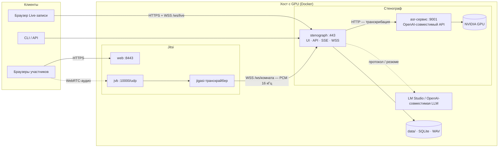
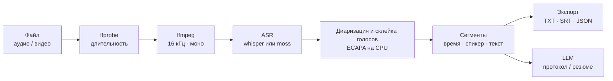
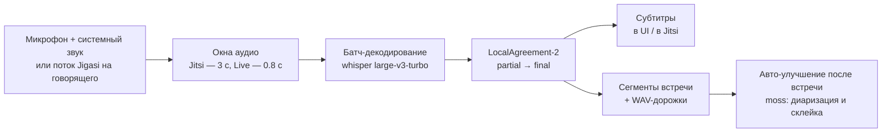

# Стенограф (Stenograph)

**Self-hosted система транскрибации встреч**: файлы (аудио/видео), живая запись
из браузера и конференции Jitsi. Распознавание речи, диаризация спикеров, живые
субтитры и LLM-протокол встречи выполняются полностью на собственном оборудовании
— данные не покидают ваш контур.

Ключевые свойства:

- **Один GPU-сервер** — ASR/диаризация на NVIDIA (CUDA); текстовая LLM —
  внешний OpenAI-совместимый сервис (например, LM Studio).
- **Единое веб-приложение** — UI, HTTP API, SSE и WebSocket-мосты отдаёт один
  процесс; состояние — SQLite и файлы в `data/`.
- **Полный стек в Docker** — Jitsi, транскрайбер Jigasi, сервер Стенографа и
  ASR-сервис поднимаются одним `docker compose`; это рекомендуемый способ
  развёртывания — [deploy/stack](deploy/stack/README.md).
- **Проверенная нагрузка** — прогоны до 18 одновременных встреч × 80 участников
  (≈1440 подключений); результаты — в разделе «Нагрузочная способность».

---

## Возможности

| Блок | Что делает |
|---|---|
| **Файлы** | Транскрипт с таймкодами и спикерами из аудио/видео. Движки: `whisper` (faster-whisper), `moss` (ASR + диаризация за проход, склейка голосов между чанками) и `gigaam` (GigaAM Multilingual — 70+ языков, лучший открытый результат для ru/kk/ky/uz). Экспорт TXT · SRT · JSON; любую задачу, включая упавшую, можно переобработать — история попыток сохраняется. |
| **Live** | Запись из браузера: микрофон («Вы») и системный звук/звук вкладки («Они»), Chrome/Edge, с любого компьютера сети. Несколько сессий одновременно. Режимы: распознавание на лету (модель `large-v3-turbo`, задержка ~1–2 с) или record-only — аудио сохраняется, точный транскрипт формируется после остановки. |
| **Jitsi** | Штатный Jigasi входит в конференцию скрытым участником и передаёт аудио каждого говорящего. Субтитры partial/final возвращаются в интерфейс Jitsi; итог — транскрипт встречи по спикерам. |
| **Плеер** | Прослушивание в задаче: у видео звук извлекается отдельной дорожкой, Live — микс и обе дорожки, Jitsi — микс встречи и дорожки спикеров. Усиление до 300 %, скорость 0.5×–2×, бесшовное переключение дорожек. |
| **Анализ** | Локальная LLM (LM Studio или любой OpenAI-совместимый сервер) собирает протокол (тема, обсуждение, решения, задачи, открытые вопросы) или резюме; длинные записи — map-reduce с прогрессом, результат — markdown. |
| **Очередь задач** | Приоритеты: эфир (Live/Jitsi) → файлы → повторные обработки. До 8 параллельных воркеров вне эфира, мгновенная отмена, автовосстановление после перезапуска сервера. |
| **Монитор** | GPU/VRAM по процессам, загруженные модели с честным статусом «в работе / простой», очередь, эфир, доступность LLM-сервера; кнопка выгрузки простаивающих моделей. |
| **Настройки** | Вкладка «Настройки» — реестр из 51 параметра по группам: часть применяется сразу, часть к новым задачам или после перезапуска (подписано у каждого пункта). Кнопка перезапуска сервера — там же. |

---

## Архитектура

### Общая схема (рекомендуемое развёртывание — Docker)



Контейнер `stenograph` работает в **remote-режиме** (`MEETSCRIBE_ASR_BACKEND=remote`):
модели он не грузит, весь ASR уходит в контейнер `asr` по HTTP. Это развязывает
API сервера и инференс — перегрузка GPU не блокирует веб-интерфейс. Подробности
развёртывания — [deploy/stack](deploy/stack/README.md).

### Конвейер файловой задачи



### Живой путь (Live и Jitsi)



Слои, очередь, движки и принятые решения — [docs/ARCHITECTURE.md](docs/ARCHITECTURE.md).
Протокол Jitsi-моста и диагностика — [docs/JITSI.md](docs/JITSI.md).

---

## Быстрый старт (Docker — рекомендуется)

Один compose-проект поднимает всё: Jitsi, Jigasi, сервер Стенографа и ASR-сервис.
Данные монтируются в папки репозитория — между перезапусками ничего не теряется.

### Требования

- Windows 10/11 x64 с Docker Desktop (WSL2) или Linux с docker engine и
  NVIDIA Container Toolkit.
- **NVIDIA GPU** с актуальным драйвером; ~10 ГБ диска под образы и модели плюс
  место под записи.
- Папка с моделями на хосте. Whisper/moss скачиваются автоматически при первом
  обращении; для движка `gigaam` положите файлы заранее —
  `huggingface-cli download ai-sage/GigaAM-Multilingual --revision ctc
  --local-dir "<папка моделей>/GigaAM-Multilingual"` (в контейнере кэш HF не
  переживает пересборку образа).
- TLS-сертификат для `:443` — `certs/stenograph.crt` + `certs/stenograph.key`
  (выпуск: `scripts/make_cert.sh`).
- Для варианта с Jitsi дополнительно свободные порты `8443/tcp`, `8081/tcp`,
  `10000/udp`.

### Шаги

```bash
git clone <repository> stenograph && cd stenograph

# 1. Настройки: скопируйте шаблон и заполните
#    MEETSCRIBE_MODELS_DIR (папка моделей), LLM, язык и т.д.
cp .env.example .env

# 2. Сертификат сервера: SAN должен включать адрес, по которому заходят
#    клиенты, и host.docker.internal — им пользуется jigasi из контейнера
bash scripts/make_cert.sh 192.168.1.10

# 3. Полный стек: Jitsi + Jigasi + Стенограф + ASR
cd deploy/stack
./start_stack.bat          # Windows; ручной запуск для Linux — в README каталога
```

Проверка:

```bash
curl -sk https://127.0.0.1/api/health     # {"status":"ok",...}
curl -s  http://127.0.0.1:9001/health     # ASR-сервис
```

Откройте `https://<адрес>/` — интерфейс Стенографа; `https://<адрес>:8443/` —
Jitsi. Субтитры включаются в комнате: *More actions → Closed captions → Start
closed captions*.

**Минимальная конфигурация без Jitsi** (файлы и Live): в том же каталоге

```bash
docker compose --env-file ../jitsi-windows/.env -f docker-compose.yml up -d --build stenograph asr
```

Порты, оговорки, обновление и диагностика — [deploy/stack/README.md](deploy/stack/README.md).

### Альтернатива: нативный запуск (для разработки)

Без Docker Desktop: Python 3.12 + Node.js 20+ (см. «Разработка»). Серверная часть
целевая на Windows (захват WASAPI, `.bat`-скрипты); на Linux работоспособна через
`uvicorn`, но этот путь в репозитории не тестируется.

```bash
uv venv --python 3.12 .venv
uv pip install --python .venv/Scripts/python.exe -e ".[dev]"
cp .env.example .env
cd frontend && npm install && npm run build && cd ..
start_server.bat      # :443 при наличии certs/, иначе :8000
```

---

## Нагрузочная способность

Стенд: Windows + Docker Desktop (WSL2), один GPU, стек в docker-режиме (сервер +
внешний ASR-сервис). Прогоны — `loadtest/run_loadtest.py`: синтетические встречи
по реальному протоколу jigasi (рампа, ротация говорящих), съём ресурсов каждые
5 с, предохранители по health/VRAM/лагу.

Профиль «ultra»: до 20 встреч, по 80 участников и 15 говорящих с ротацией каждые
20 с — на пике **18 встреч ≈ 1440 одновременных подключений и ~270 говорящих
потоков**.

| Наблюдение | Результат трёх полных прогонов (11.10.2026) |
|---|---|
| Сервер Стенографа | Жив всю рампу: лаг event loop ≤ 0.47 с на пике, без перезапусков; все потоки принимаются и сохраняются. |
| Записи встреч | Транскрибация всех записей завершена: 18 встреч за прогон, от 15 до 1074 сегментов на встречу (≈4.6 тыс. сегментов суммарно); авто-улучшения (moss, до 80 дорожек) досчитаны. |
| ASR-сервис (GPU) | 98–100 % GPU, до ~460 % CPU — узкое место конфигурации. |
| Живые субтитры на пике | Отставание растёт до ~280 с к концу рампы (коэффициент успевания ≤ 0.05): на 18 встречах GPU не успевает за реальным временем. Это деградация по пропускной способности, а не отказ: очередь принимается и досчитывается. |
| Смоук 1 встреча × 10 говорящих | Отставание ≤ ~10 с; GPU 98 %, CPU сервиса ~460 %, лаг сервера 16 мс. |

Границы, которые стоит понимать:

- **Бутылочное горло — один GPU.** Число встреч, обслуживаемых в реальном
  времени, масштабируется ускорением, а не сервером Стенографа.
- **Перегрузка не ломает сервер.** Очереди кэпируются по участнику и по серверу
  в целом (дроп старейших кадров с предупреждением; аудио на диске не страдает),
  прогон останавливают его собственные стены (health / VRAM / лаг), зафиксированные
  в `summary.json`.
- На пике шторма переподключений (~1500 TCP-соединений) внешняя health-проба
  через docker-прокси может дать сбои — предохранитель раннера это ловит; сам
  сервер отвечает, рестартов нет.

Полные трассы, графики и методика — [loadtest/README.md](loadtest/README.md).

---

## Конфигурация

Все параметры — переменные `MEETSCRIBE_*` в `.env` (полный список с комментариями
— [.env.example](.env.example)). Основные:

| Переменная | По умолчанию | Назначение |
|---|---|---|
| `MEETSCRIBE_ENGINE` | `whisper` | движок по умолчанию: `whisper` (faster-whisper), `moss` или `gigaam` |
| `MEETSCRIBE_REPROCESS_ENGINE` | — | движок повторной обработки (иначе — движок по умолчанию) |
| `MEETSCRIBE_ASR_BACKEND` | `local` | `local` — движки в процессе сервера; `remote` — внешний ASR-сервис (так работает стек) |
| `MEETSCRIBE_ASR_URL` | `http://127.0.0.1:9001` | адрес внешнего ASR-сервиса (в стеке — `http://asr:9001`) |
| `MEETSCRIBE_DATA_DIR` | `./data` | задачи, загрузки, БД, аудио, оверрайды настроек |
| `MEETSCRIBE_MODELS_DIR` | — | каталог локальных моделей (иначе — загрузка с HF) |
| `MEETSCRIBE_FFMPEG` / `MEETSCRIBE_FFPROBE` | `ffmpeg` / `ffprobe` | пути к бинарям |
| `MEETSCRIBE_DEVICE` / `MEETSCRIBE_COMPUTE_TYPE` | `cuda` / `float16` | устройство и точность faster-whisper |
| `MEETSCRIBE_LANGUAGE` | `auto` | язык распознавания |
| `MEETSCRIBE_LIVE_MODEL` | `large-v3-turbo` | модель живого декодирования (Live/Jitsi) |
| `MEETSCRIBE_LIVE_ENGINE` | `whisper` | движок окон субтитров Live/Jitsi: `whisper` (turbo) или `gigaam` |
| `MEETSCRIBE_GIGAAM_MODEL` | `ai-sage/GigaAM-Multilingual` | модель GigaAM: HF-репозиторий или папка в каталоге моделей |
| `MEETSCRIBE_GIGAAM_REVISION` | `ctc` | ревизия GigaAM: `ctc` (220M, быстрая) или `large_ctc` (600M, точнее) |
| `MEETSCRIBE_GIGAAM_COPIES` | `1` | копий GigaAM в ASR-сервисе (1–4): копия поднимается при конкуренции, если хватает свободной VRAM |
| `MEETSCRIBE_REALTIME_TRANSCRIBE` | `false` | декодирование по ходу записи (иначе record-only) |
| `MEETSCRIBE_FILE_WORKERS` | `1` | параллельных воркеров очереди, 1–8; каждый держит свою копию модели |
| `MEETSCRIBE_RESTART_RECOVER` | `true` | подхват работы после остановки сервера (см. «Эксплуатация») |
| `MEETSCRIBE_MODEL_IDLE_UNLOAD_SEC` | `600` | выгрузка простаивающих моделей (0 — выключено) |
| `MEETSCRIBE_JITSI_IDLE_STOP_SEC` | `600` | авто-стоп Jitsi-встречи после N с без речи (0 — выключено) |
| `MEETSCRIBE_LIVE_AUTO_REPROCESS` | `true` | авто-улучшение записей Live (moss) после остановки |
| `MEETSCRIBE_LLM_BASE_URL` | `http://127.0.0.1:1234/v1` | OpenAI-совместимый сервер для анализа |
| `MEETSCRIBE_LLM_MODEL` | `gemma-3-4b-it` | модель анализа |

**Рантайм-настройки.** Вкладка «Настройки» редактирует те же параметры без правки
файлов; изменения сохраняются в `data/settings_overrides.json` и переживают
перезапуск. Приоритет значений: **оверрайд из UI → `.env`/окружение → умолчание в
коде**. Источник виден в интерфейсе («изменено» / «из окружения»).

---

## HTTP API

JSON; события — SSE (`GET /api/jobs/{id}/events`) и WebSocket (`/ws/live`,
`/ws/{meeting}`). Полная спецификация — Swagger UI (`/docs`) и `/openapi.json` на
работающем сервере.

| Группа | Эндпоинты |
|---|---|
| Задачи | `GET/POST /api/jobs`, `GET/DELETE/PATCH /api/jobs/{id}`, `POST /api/jobs/{id}/cancel · retry · reprocess · analyze`, `GET /api/jobs/{id}/audio[/{track}]` |
| Live | `POST /api/live/start · stop`, `GET /api/live/status · devices`, `WS /ws/live` |
| Jitsi | `GET /api/jitsi/status`, `POST /api/jitsi/transcribe · stop`, `WS /ws/{meeting}` |
| Настройки и сервер | `GET/PATCH /api/settings`, `POST /api/settings/reset`, `POST /api/server/restart` |
| Служебные | `GET /api/health · config · engines · queue · stats · metrics`, `POST /api/models/unload` |

---

## Эксплуатация

### Перезапуск сервера

Кнопка **«Перезапустить сервер»** (вкладка «Настройки», карточка «Сервер»)
применяет параметры с пометкой «после перезапуска». В докере контейнер
перезапускает политика `restart: unless-stopped`; нативный сервер заменяет процесс
сам. Восстановление работы — `MEETSCRIBE_RESTART_RECOVER` (по умолчанию включено):
очередь возвращается на места, прерванные задачи перезапускаются в тех же записях,
Live/Jitsi помечаются «Прервано остановкой сервера» (аудио на диске сохраняется —
транскрипт строится кнопкой «Улучшить»). Факт восстановления — строкой
`restart recovery: N requeued, M restarted, K marked interrupted` в логе.

### Параллельные воркеры и модели

`MEETSCRIBE_FILE_WORKERS` (1–8) задаёт параллелизм очереди вне эфира; пока идёт
Live или Jitsi — фоновые задачи ждут. Каждый воркер лениво создаёт **свою копию**
движка (ориентир VRAM: `moss` ≈ 1.9 ГБ, `whisper-large` ≈ 3.7 ГБ, `turbo` ≈
2.2 ГБ). Простаивающие модели выгружает сборщик `MEETSCRIBE_MODEL_IDLE_UNLOAD_SEC`
(и кнопка «Выгрузить простаивающие» на «Мониторе»); модели, использованные
меньше минуты назад, не выгружаются ничем — окна Live приходят раз в несколько
секунд, и без этой защиты движок встречи выгружался бы между батчами. Задачи
берутся по классу приоритета (эфир → файлы → обработки), ни одна не достаётся
двум воркерам сразу.

В ASR-сервисе GigaAM может держать несколько копий
(`MEETSCRIBE_GIGAAM_COPIES`, 1–4): когда все копии заняты, сервис фоново
поднимает и прогревает ещё одну — если свободной VRAM хватает (оценка ~1 ГБ на
копию `ctc` + запас) — и файловые задачи с окнами Live/Jitsi перестают ждать
друг друга.

### HTTPS и сертификаты

TLS терминирует сам сервер (uvicorn, `:443`) — прокси не нужен: страницы, API,
SSE и мост Jitsi живут на одном порту. Сертификат — конфигурация:
`certs/stenograph.crt` + `certs/stenograph.key` (или `TLS_CERT_FILE` /
`TLS_KEY_FILE`); SAN должен включать адрес клиентов и `host.docker.internal`
(его использует jigasi из контейнера). Выпуск: `scripts/make_cert.sh <IP-или-имя>`.
Браузеры дают доступ к микрофону только на HTTPS (исключение — localhost) — для
Live с других машин сертификат обязателен. Клиентам — один раз доверить `ca.crt`
(`install-ca.bat` / `certutil`).

---

## Структура репозитория

```
src/stenograph/         сервер и ядро
├── domain/             модели и ошибки
├── engines/            ASR/диаризация за протоколами + реестр (whisper, moss, remote)
├── live/               Live: браузерный захват и WASAPI, потоковые сессии
├── bridge/             Jitsi-мост: протокол streaming-whisper для Jigasi
├── llm/                анализ встречи: клиент, промпты, map-reduce
├── api/                FastAPI: HTTP + SSE + WebSocket
├── service.py          очередь задач, воркеры, отмена, восстановление
├── pipeline.py         стадии обработки, переходы состояний
├── asr_service.py      внешний ASR-сервис (OpenAI-совместимый API)
├── settings_service.py реестр рантайм-настроек и оверрайды
├── storage.py          SQLite-репозиторий задач (WAL)
├── events.py           шина событий (SSE/WebSocket)
└── cli.py              консоль `stenograph`
frontend/               веб-интерфейс (React 19 + TypeScript + Vite)
deploy/stack/           полный стек в Docker — рекомендуемое развёртывание
deploy/jitsi-windows/   Jitsi-стенд (compose + jigasi) и общие конфиги
docs/                   ARCHITECTURE.md, JITSI.md
loadtest/               нагрузочные прогоны: раннер, графики, результаты
scripts/                служебные скрипты (сертификаты, проверки)
tests/                  автотесты (pytest)
```

Движки подключаются как плагины: новый — модуль с реализацией протоколов из
`engines/base.py` плюс регистрация в `engines/__init__.py`; ядро о конкретных
моделях не знает.

---

## Разработка

```bash
.venv/Scripts/python.exe -m pytest        # автотесты
uv run ruff check src tests               # стиль
uv run mypy src                           # типы
cd frontend && npx tsc --noEmit           # типы фронтенда
```

После правок фронтенда — `npm run build`: папка `frontend/dist` раздаётся сервером;
в docker-стек попадает из образа — пересоберите контейнеры.

---

## Ограничения

- Серверный захват звука (WASAPI) — Windows; такая сессия одна на сервер
  (браузерных Live-сессий — сколько угодно).
- Живое распознавание ограничено GPU: при перегрузке растёт задержка, а не
  теряется аудио (очереди принимаются и досчитываются).
- Транскрибация Jitsi возможна для собственного Jitsi с Jigasi; для внешних
  встреч — захват системного звука через Live.
- Движок `moss` требует extra `[moss]` и CUDA-сборки torch (в Docker-образе уже
  включён).
