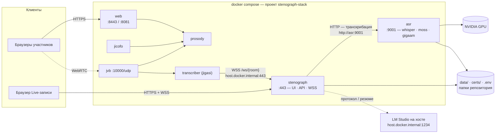

# Полный стек в Docker: Jitsi + Стенограф + ASR-сервис

Рекомендуемый способ развёртывания: один `docker compose` (проект
`stenograph-stack`) поднимает всю систему целиком — Jitsi, jigasi-транскрайбер,
сервер Стенографа и внешний ASR-сервис с GPU. Все данные живут в папках
репозитория и монтируются в контейнеры «на месте» — между перезапусками ничего
не копируется и не теряется.



## Сервисы и порты

| Сервис | Что это | Порты на хосте |
|---|---|---|
| `web`, `prosody`, `jicofo`, `jvb` | Jitsi с локального стенда (docker-jitsi-meet) | `8081` (http), `8443` (https), `10000/udp` |
| `transcriber` | jigasi — передаёт звук комнат на мост Стенографа | — |
| `stenograph` | сервер: UI + API + мост | `443` |
| `asr` | ASR-сервис (whisper, moss, gigaam) | `127.0.0.1:9001` (только loopback) |

## Как это связано

- Браузеры ходят на `https://<этот-хост>:8443/` (Jitsi) и `https://<этот-хост>/`
  (Стенограф).
- jigasi из контейнера дозванивается до моста по `wss://host.docker.internal/ws`
  — это хост-порт 443, который публикует контейнер `stenograph`. В самом Jitsi
  ничего не меняется: используется штатный `WhisperTranscriptionService`.
- Контейнер `stenograph` запущен с `MEETSCRIBE_ASR_BACKEND=remote` — модели он не
  грузит, весь ASR уходит по HTTP в контейнер `asr` (внутренняя сеть компоуза).
  Перегрузка GPU не блокирует API и веб-интерфейс сервера.
- `asr` — единственный контейнер с GPU: карта выдаётся через
  `deploy.resources.reservations.devices`, модели читаются из папки на хосте.
- LLM-анализ идёт на хост: LM Studio на `host.docker.internal:1234` (включите в
  LM Studio «Serve on Local Network», иначе он слушает только 127.0.0.1).

## Данные — примонтированы «на месте»

| Хост | В контейнере | Что там |
|---|---|---|
| `..\..\data` | `/app/data` | задачи, загрузки, SQLite, рабочие файлы, оверрайды настроек |
| `..\..\certs` | `/app/certs` | TLS-сертификат сервера |
| `..\..\.env` | `/app/.env` | настройки `MEETSCRIBE_*` (читаются, не пишутся) |
| `..\jitsi-windows\config` | тома Jitsi | состояние стенда: prosody, jvb, jigasi, ключи |
| папка моделей (`STENOGRAPH_MODELS_DIR`) | `/models` | модели whisper/moss/gigaam: rw для `asr`, ro для `stenograph` |

## Запуск

1. Остановите то, что занимает те же порты:
   - standalone-стенд Jitsi: `deploy\jitsi-windows\stop.bat`;
   - нативный сервер Стенографа: Ctrl+C в его окне (`start_server.bat`).
2. Запуск (Windows):

   ```
   deploy\stack\start_stack.bat
   ```

   или вручную (кроссплатформенно):

   ```
   cd deploy/stack
   docker compose --env-file ../jitsi-windows/.env -f docker-compose.yml up -d --build
   ```

   `start_stack.bat` сам подставляет `..\jitsi-windows\.env` — **тот же** файл с
   паролями Jitsi, что и у стенда: состояние в `config/` остаётся логинящимся.
3. **Первая сборка долгая** (~10–25 мин): скачиваются CUDA-torch, transformers,
   MOSS. Дальнейшие пересборки — секунды (кэш слоёв), обычный перезапуск —
   `up -d` без `--build`.

### Минимальная конфигурация без Jitsi

Нужны только файлы и Live — поднимите два сервиса:

```bash
docker compose --env-file ../jitsi-windows/.env -f docker-compose.yml up -d --build stenograph asr
```

## Проверка

```bash
docker compose --env-file ../jitsi-windows/.env -f docker-compose.yml ps
curl -sk https://127.0.0.1/api/health          # сервер Стенографа
curl -s  http://127.0.0.1:9001/health          # ASR-сервис (loopback)
curl -s  http://127.0.0.1:9001/v1/models
```

End-to-end: позвоните в любую комнату Jitsi — jigasi подключится к мосту,
субтитры пойдут, в «Задачах» появится запись «Jitsi — …». Файл: загрузите через
UI — задача уйдёт в `asr`.

## Настройки

Переменные окружения (`.env` этого каталога или `..\jitsi-windows\.env`):

| Переменная | По умолчанию | Смысл |
|---|---|---|
| `STENOGRAPH_MODELS_DIR` | `G:/LLMs/models` | папка моделей на хосте |
| `ASR_HOST_PORT` | `9001` | порт ASR-сервиса на хосте (только 127.0.0.1) |
| `STENOGRAPH_IMAGE` | `stenograph-stack:local` | имя образа стека |
| `STACK_CONFIG` | `../jitsi-windows/config` | каталог состояния Jitsi |
| `RESTART_POLICY` | `unless-stopped` | политика перезапуска контейнеров (ей пользуется и кнопка «Перезапустить сервер» в UI) |

Из `..\..\.env` контейнер `stenograph` читает всё остальное (движок, язык,
пороги, LLM, выгрузка моделей по простою…); из `..\jitsi-windows\.env` — пароли
и порты Jitsi. Рантайм-правки из вкладки «Настройки» сохраняются в
`data/settings_overrides.json` и переживают перезапуск (приоритет: UI-оверрайд →
`.env` → умолчания).

## Обновление после правок кода

```bash
cd deploy/stack
docker compose --env-file ../jitsi-windows/.env -f docker-compose.yml up -d --build stenograph
```

Фронтенд попадает в образ из `frontend\dist` — сначала `npm run build` в
`frontend/`, затем пересборка контейнера. Учтите: образом пользуются **оба**
сервиса (`stenograph` и `asr`) — при пересборке compose может пересоздать и
`asr`, поэтому деплой делайте в спокойное окно: активные задачи, считающиеся в
`asr`, при его пересоздании падают с «ASR service unreachable» (записи на диске
не страдают — улучшения можно запустить заново).

## Оговорки и диагностика

- **Монитор в стеке**: карточка «Внешний ASR-сервис» показывает модели из `asr`
  (VRAM/RAM/простой; кнопка «Выгрузить простаивающие» работает через прокси);
  GPU в верхних карточках берётся из сервиса — в контейнере сервера nvidia-smi
  нет.
- **Движок `gigaam`** (ai-sage/GigaAM-Multilingual): файлы модели положите в
  `<папка моделей>/GigaAM-Multilingual` —
  `huggingface-cli download ai-sage/GigaAM-Multilingual --revision ctc --local-dir "<папка моделей>/GigaAM-Multilingual"`
  (иначе сервис скачает их в HF-кэш контейнера, и пересборка образа их
  потеряет). Для окон Live/Jitsi — `MEETSCRIBE_LIVE_ENGINE=gigaam` в `.env`.
- **LLM из контейнеров** идёт на `host.docker.internal:1234`; при выключенном
  «Serve on Local Network» Монитор честно покажет «не отвечает».
- Контейнер `stenograph` работает только в remote-режиме (локальные модели — это
  нативный запуск; GPU резервируется только у `asr`).
- Нативный сервер и стек **нельзя запускать одновременно** — общий порт 443.
- `..\..\.env` монтируется как файл: если его удалить и запустить стек, Docker
  создаст на его месте *папку* — верните файл (`git checkout .env`).
- Если у `asr` нет GPU: проверьте Docker Desktop → Resources → WSL2 и драйвер
  NVIDIA; `docker run --rm --gpus all nvidia/cuda:12.4.1-base-ubuntu22.04 nvidia-smi`
  должен показывать карту.
- Логи: `docker compose --env-file ../jitsi-windows/.env -f docker-compose.yml logs -f stenograph asr`.
