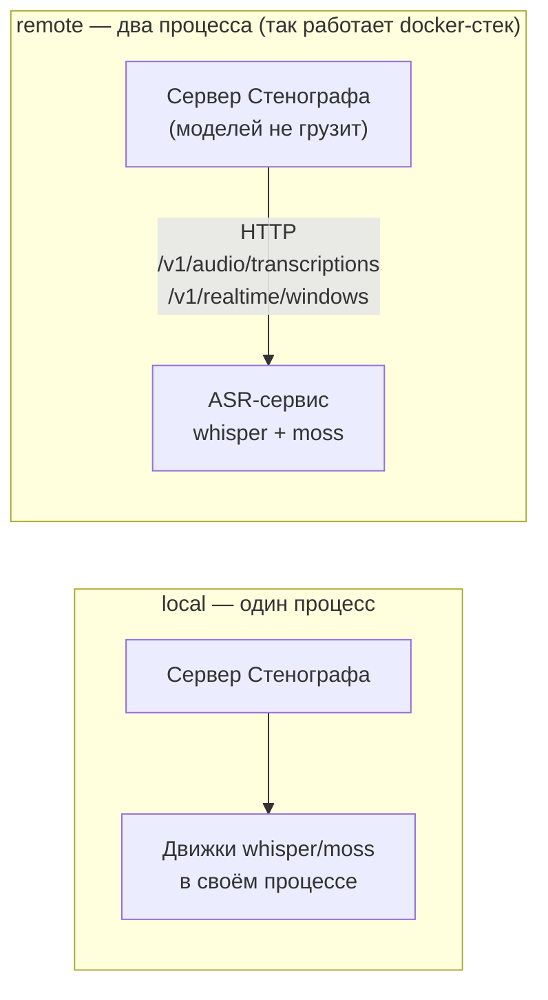
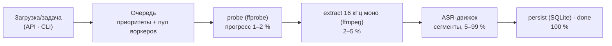

# Архитектура «Стенографа»

Документ описывает слои, потоки данных и принятые решения. Состояние — по
текущей реализации в репозитории.

## Слои и зависимости

```
domain/               модели и ошибки; ни от чего не зависят
engines/              протоколы + реализации ASR/диаризации + реестр
media.py              ffmpeg: probe, извлечение 16 кГц моно
storage.py            SQLite-репозиторий задач (WAL, версия схемы)
events.py             шина событий (fan-out, потокобезопасная)
model_budget.py       бюджет моделей: выгрузка по простою, уступка при загрузке
settings_service.py   рантайм-реестр настроек, оверрайды, апплаеры побочек
pipeline.py           стадии файловой задачи + переходы состояний
service.py            очередь задач, пул воркеров, отмена, восстановление
live/                 Live-сессии: захват, потоковое декодирование, очередь ходов
bridge/               Jitsi-мост: WebSocket streaming-whisper для Jigasi
llm/                  анализ встречи: клиент, промпты, map-reduce
asr_client.py         клиент внешнего ASR-сервиса (+ отмена по request_id)
asr_service.py        внешний ASR-сервис: те же движки по OpenAI-совместимому API
metrics.py, loopwatch.py  метрики процессов/GPU и сторож лага event loop
server_control.py     перезапуск сервера по кнопке из UI
api/                  FastAPI: тонкие роутеры, SSE, WebSocket
cli.py                тот же конвейер из командной строки
```

Зависимости направлены вниз: `api/cli → service → pipeline → engines →
domain`. Обратных зависимостей нет. Ядро не знает о конкретных моделях:
ASR- и диаризация-движки подключаются за протоколами (`engines/base.py`) через
реестр (`engines/__init__.py`); новый бэкенд — новый модуль.

## Режимы ASR: local и remote

Ядро работает с движками через один интерфейс, но место инференса
переключается настройкой `MEETSCRIBE_ASR_BACKEND`:



Мотив remote-режима: инференс отделён от API — перегрузка GPU (многоминутные
MOSS-проходы) не блокирует event loop сервера и веб-интерфейс. Дополнительно
появилась возможность точечно отменять выполняющиеся запросы: у каждого вызова
есть `request_id`, и отмена задачи из UI доходит до сервиса
(`POST /v1/transcriptions/cancel`) вместо досчитывания записи целиком.

## Конвейер файловой задачи



Прогресс сохраняется в БД с троттлингом (~1 с); в SSE события уходят по мере
поступления. Отмена — кооперативная: `threading.Event` («токен» на задачу),
движок проверяет его между сегментами (и в MOSS — по токенам генерации) и
бросает `JobCancelled`.

## Очередь и пул воркеров

- Все задачи обрабатывает **пул воркеров** (`service.py`). Вне эфира очередь
  могут обслуживать до 8 воркеров (`MEETSCRIBE_FILE_WORKERS`); по умолчанию 1 —
  строгая последовательность. Каждый воркер держит **свои** копии движков
  (кэш на слот), поэтому модели не разделяются между потоками.
- Задачи берутся по классу приоритета: файлы → повторные обработки →
  авто-улучшения (`PRIORITY_*`), ни одна задача не достаётся двум воркерам
  сразу (claim под локом).
- Пока активен эфир (идёт Live-запись или Jitsi-встреча), тяжёлые фоновые
  задачи не стартуют и уступают на безопасных точках (у `moss` — между
  чанками); после эфира очередь продолжается с тех же мест. Признак в UI —
  «Ждёт: идёт живая запись».
- **Отмена мгновенная**: `GET .../cancel` финализирует ждущие задачи сразу
  (статус «Отменено», вылет из пула), а для бегущих — прокидывает сигнал в
  движок; у remote-вызовов сторож (0.5 с) шлёт отмену в ASR-сервис.
- **Восстановление после перезапуска** (`MEETSCRIBE_RESTART_RECOVER`): при
  старте очередь возвращается на места, прерванные задачи перезапускаются в тех
  же записях; Live/Jitsi помечаются «Прервано остановкой сервера» (дорожки на
  диске сохраняются — транскрипт строится «Улучшением»). Итог — строкой
  `restart recovery: N requeued, M restarted, K marked interrupted` в логе.

## Движки

**whisper** (faster-whisper). Файлы — `large-v3` (устройство и точность —
`MEETSCRIBE_DEVICE` / `MEETSCRIBE_COMPUTE_TYPE`); Live/Jitsi — `large-v3-turbo`,
greedy. Батч-декод окон live-очереди использует приватные внутренности
faster-whisper (`BatchedInferencePipeline` без VAD) — при обновлении библиотеки
перепроверять.

**moss** (MOSS-Transcribe-Diarize). ASR + диаризация за проход. Длинные записи
режутся на чанки по 300 с с перехлёстом 2 с; дубликаты на границах снимаются по
времени и схожести текста. Метки спикеров локальны для чанка, поэтому после
декодирования всех чанков выполняется сквозная склейка голосов: сегменты ≥0.8 с
эмбеддятся ECAPA-TDNN (speechbrain, CPU), кластеризация average-linkage по
косинусу; кластеры короче 10 с речи приклеиваются к ближайшему похожему, иначе
сохраняются отдельными. Одночанковые записи не затрагиваются. При ошибке
эмбеддера — warning и локальные метки (транскрибация не падает).

**remote**. Дроп-ин замена движков: файл уходит целиком
(`/v1/audio/transcriptions`), окна realtime — батчами (`/v1/realtime/windows`).
Клиент резолвит адрес сервиса на каждый вызов (смена `asr_url` в «Настройках»
подхватывается без перезапуска), отмена — по `request_id`.

**LLM** (протокол/резюме). OpenAI-совместимый клиент; длинные транскрипты
обрабатываются map-reduce по чанкам (`MEETSCRIBE_LLM_CHUNK_CHARS`).

Движок по умолчанию — `MEETSCRIBE_ENGINE`; повторная обработка — отдельный
параметр `MEETSCRIBE_REPROCESS_ENGINE` (если не задан — движок по умолчанию).

## Live-режим

**Захват.** Браузерный: `getUserMedia` (микрофон → «Вы») + `getDisplayMedia`
(звук системы/вкладки → «Они»), 16 кГц моно, кадры ~100 мс в `WS /ws/live`.
Серверный: PyAudioWPatch/WASAPI — loopback устройства вывода («Они») + микрофон
(«Вы»), чанки 0.2 с; одновременно не более одной серверной сессии (устройства
машины общие). Браузерных сессий — сколько угодно.

**Режимы.** `MEETSCRIBE_REALTIME_TRANSCRIBE=true` — декодирование по ходу
записи; `false` (по умолчанию) — record-only: сохраняется только аудио,
транскрипт формируется после остановки.

**Декодирование** (realtime). `StreamTracker` на каждый трек: окно нестабильного
аудио, инференс раз в `live_step_sec` (0.8 с), коммит слов, согласованных в двух
последовательных гипотезах (LocalAgreement-2); тишина отсекается по RMS;
закоммиченное аудио выбрасывается из окна, переросшее окно коммитится
принудительно. Модель — whisper-turbo, greedy. Сессии получают ходы по кругу
(до `live_turn_ticks` инференсов и `live_turn_sec` секунд GPU на сессию за ход),
окна объединяются в батч-проходы.

**Сессия** — задача (`kind="live"`): тот же SSE-контракт (плюс события `partial`
и `level`), дорожки в `data/live/<id>/<track>.wav`. Захват живёт в модульном
сторе фронтенда (`frontend/src/live/session.ts`), а не в компоненте страницы:
переход по вкладкам запись не прерывает. Остановить сессию можно откуда угодно
(`POST /api/live/stop` с `job_id`; сервер закрывает upload-сокет). При
завершении записи недораспознанный хвост можно отбросить
(`drop_realtime_on_finalize`) — ресурсы не тратятся, запись на диске полная.

**Повторная обработка.** После остановки создаётся дочерняя задача
(`kind="reprocess"`): дорожки перетранскрибируются движком повторной обработки,
сегменты сливаются в общий таймлайн — микрофон помечается «Вы», системная
дорожка сохраняет диаризованные метки. Связь — `meta.parent` /
`meta.reprocess_job`; автозапуск — `MEETSCRIBE_LIVE_AUTO_REPROCESS`.

## Jitsi-мост

Jigasi в режиме транскрайбера подключается к `WS /ws/{meeting_id}` и шлёт
бинарные кадры: заголовок 60 байт `participantId|language` + PCM 16 кГц; ответы —
JSON `{"type": "partial"|"final", ...}` (протокол jitsi/skynet
streaming-whisper, Apache-2.0). Идентификатор говорящего приходит в заголовке,
поэтому акустическая диаризация не нужна: спикеры — по участникам. Мост ведёт
выровненный по часам встречи таймлайн: кадры ставятся на позицию «приход −
длительность», паузы заполняются тишиной; итог — дорожки полной длины, микс
«вся встреча» и та же временная шкала у транскрипта. Детали и диагностика —
`docs/JITSI.md`.

**Гварды перегрузки**: каждая встреча и сервер в целом имеют кэпы очередей
(`MEETSCRIBE_BRIDGE_DRAIN_MAX_SEC`, `..._PENDING_MAX_SEC`,
`..._TOTAL_PENDING_MAX_SEC`) — при перегрузке дропаются старейшие кадры с
предупреждением (аудио на диске не страдает), финализация бэклога ограничена
`MEETSCRIBE_BRIDGE_FINALIZE_CONCURRENCY`.

## Настройки в рантайме

`settings_service.py` — реестр из 51 параметра (типы, диапазоны, human-подписи,
когда применяется) поверх объекта `Settings`. Изменения из вкладки «Настройки»:

- применяются к живому объекту настроек (потребители читают значения в момент
  использования);
- сохраняются в `data/settings_overrides.json` (атомарная запись) и
  поднимаются при старте **до** сборки компонентов;
- приоритет: оверрайд из UI → `.env`/окружение → умолчания в коде;
- часть ключей требует перезапуска (выбор движков, порт сервиса) — это честно
  подписано в UI; кнопка «Перезапустить сервер» (`server_control.py`) применяет
  их: в докере — SIGTERM и политика рестарта, нативно — re-exec.

## Веб-интерфейс

React 19 + TypeScript + Vite + Tailwind; сборка в `frontend/dist` раздаётся тем
же FastAPI (SPA-fallback; API-роуты приоритетны, неизвестные `/api/*` — 404).
Данные: дашборд — `/api/stats` + `/api/queue` (поллинг ~2 с, ETA на клиенте);
страница задачи — `/api/jobs/{id}/events` (SSE: snapshot → status/progress →
segment → segments_replaced → done/error); монитор — `/api/metrics`
(снапшот процессов, GPU, моделей, эфира и внешнего ASR-сервиса).

## Хранилище и события

SQLite (WAL) — задачи, сегменты, метаданные (`meta.*`: имена спикеров, связи
задач, движок, отчёт клиента). `events.py` — потокобезопасная шина fan-out:
SSE-потоки, WebSocket-подписки Live/Jitsi и CLI получают одни и те же события.

## Принятые решения

1. ASR и диаризация — локально или во внешнем сервисе (remote-режим); текстовая
   LLM — отдельный OpenAI-совместимый сервис: снимает конкуренцию за VRAM и
   версии библиотек.
2. Спикеры Live/Jitsi берутся из источника (дорожки / participant id), а не
   акустической диаризацией на лету; диаризация — на постобработке (moss).
3. Приоритет эфира в общей очереди; сохранность аудио при задержках
   обеспечивается буферизацией и догоном, а не дропом.
4. Пул воркеров вместо единственного декодера — параллелизм фоновых задач без
   потери детерминизма данных (claim, приоритеты, кэш движков на слот).
5. TLS терминирует сам сервер (uvicorn, `:443`); внешний прокси не нужен —
   страницы, API, SSE и мост Jigasi живут на одном порту.
